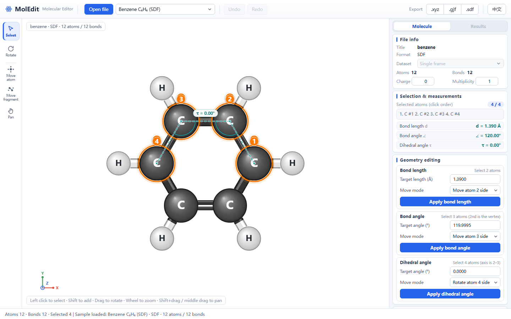
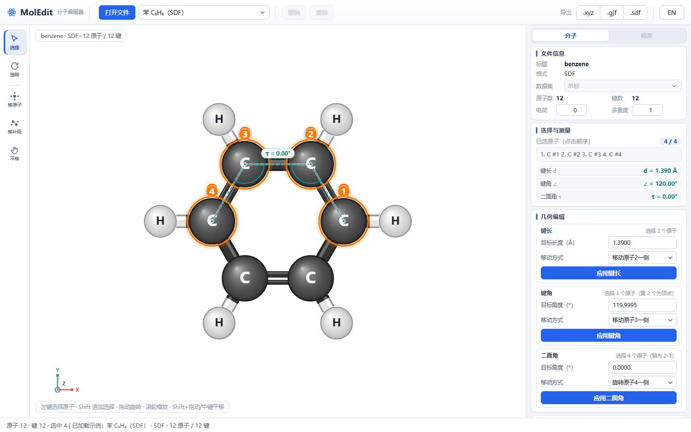
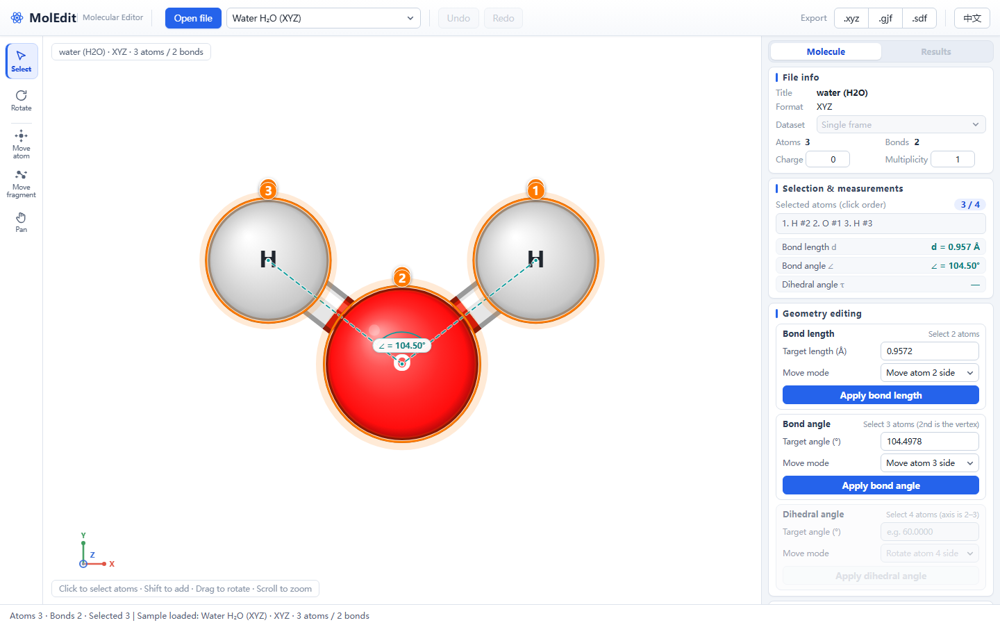
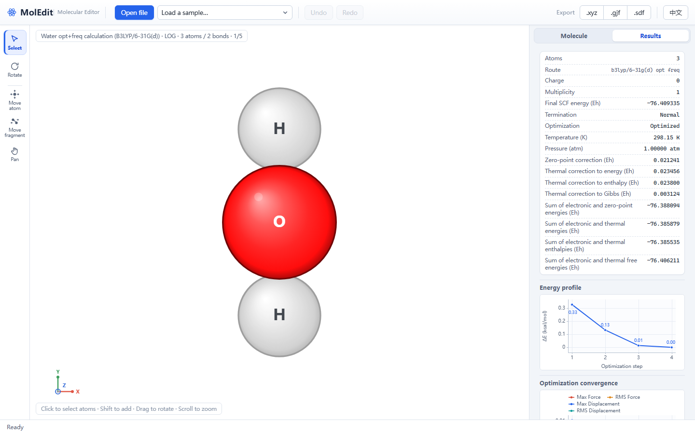
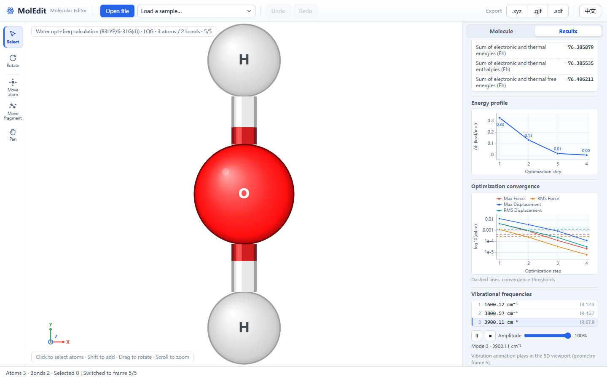
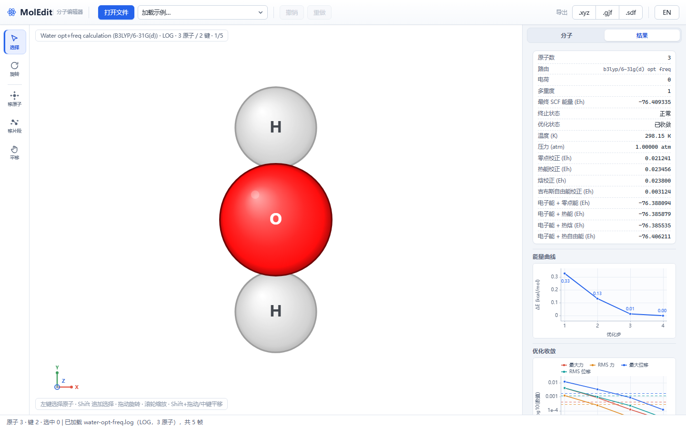
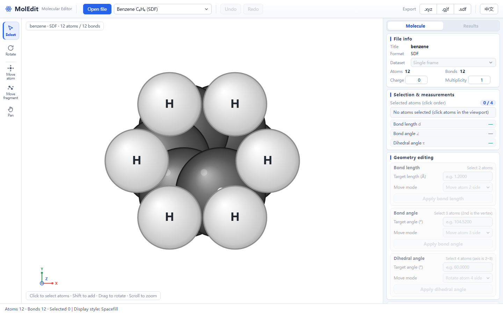
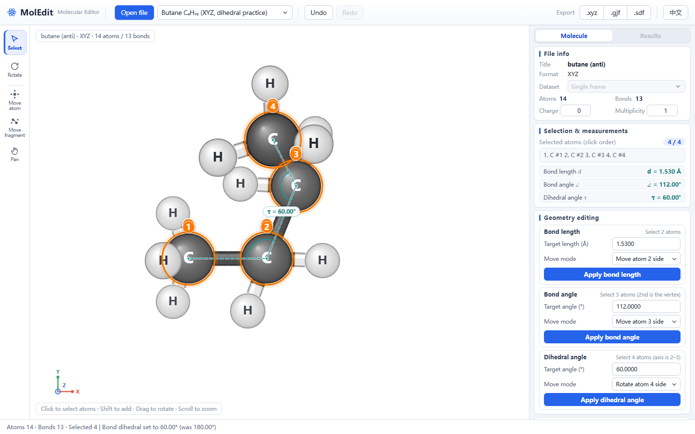

# MolEdit — a GaussView-style molecular editor

A **fully offline, dependency-free** browser-based molecular editor: open `.xyz` / `.sdf` / `.gjf` / `.log` files, view molecules as 3D ball-and-stick models, measure and precisely edit **bond lengths**, **bond angles** and **dihedral angles** just like GaussView, inspect Gaussian calculation results, and export back to Gaussian input / XYZ / SDF.

The UI is **bilingual (English / Chinese) and defaults to English**. It runs on Windows, Linux and macOS — just a modern browser is required (Chrome / Edge / Firefox / Safari).

[English](#moledit--a-gaussview-style-molecular-editor) | [中文](#中文说明)



---

## Features

| Area | Feature |
| --- | --- |
| Input formats | `.xyz` (including multi-frame trajectories), `.sdf`/`.mol` (V2000, multi-record), `.gjf`/`.com` (Gaussian input, including `geom=connectivity` and `--Link1--` multi-job), `.log`/`.out` (Gaussian 03/09/16 output; Standard orientation extraction, multi-frame optimization trajectories) |
| Gaussian LOG results | Opening a `.log` automatically switches to the **Results** tab: **single-point energy** (final SCF Done), **thermochemical corrections** (ZPE, thermal corrections, Sum of electronic and …), **optimization profiles** (energy vs. step + 4 convergence criteria vs. thresholds), **frequency analysis** (frequency/IR table, imaginary modes highlighted) with **animated normal-mode vibrations** (play / pause / stop / amplitude) |
| 3D visualization | Canvas 2D ball-and-stick renderer; ball-and-stick / space-fill / stick / wireframe styles; element labels and atom indices; axes triad; depth sorting, shaded spheres, multiple bonds (double/triple/aromatic) |
| Interaction | Drag to rotate, wheel to zoom, Shift+drag / middle-drag to pan; click to select, Shift+click to add (up to 4 atoms); hover highlight; move-atom / move-fragment tools |
| Measurements | Two-atom bond length (Å), three-atom bond angle (°, vertex = 2nd selected atom), four-atom dihedral (°, axis = atoms 2→3, range −180°…180°) |
| Geometry editing | Enter a target value and press **Apply**: bond length = translate one side of the bond; bond angle = rotate one side around the vertex; dihedral = rotate one side around the B–C axis. Choose which side to move (atom 1 / atom 2 / smaller fragment) |
| Undo / redo | 50-step history (including atom dragging); `Ctrl+Z` / `Ctrl+Shift+Z` / `Ctrl+Y` |
| Export | Download `.xyz`, `.gjf` (with charge/multiplicity and `geom=connectivity`) and `.sdf` (V2000) |
| Languages | English / Chinese switch; **English by default**; the choice is remembered in `localStorage` |
| Cross-platform | Windows (Start Menu shortcut / `.bat`), Linux (`launch.sh` / desktop-entry script), macOS (`MolEdit.command` / `launch.sh`) |
| Extras | Drag & drop files; built-in sample library; multi-frame / multi-record navigation; charge and multiplicity editing |

> The editing algorithms modify only the requested geometric parameter and **do not distort the rest of the molecule**: bond-length edits translate a whole fragment; angle/dihedral edits rigidly rotate a whole fragment.

---

## Quick start

> The app is plain static HTML/JS/CSS: **no installation and no network access are required**, only a modern browser.

### Windows

- **Option 1 (recommended)**: search the Start Menu for **“MolEdit”** and click the **MolEdit Molecular Editor** shortcut (installed for the current user);
- **Option 2**: double-click [`Open-MolEdit.bat`](Open-MolEdit.bat) (or double-click `index.html` directly);
- **Option 3**: double-click [`Start-Local-Server.bat`](Start-Local-Server.bat) to serve via <http://127.0.0.1:8777/> (use this if `file://` is restricted).

> The Start Menu shortcut launches [`launch.vbs`](launch.vbs), which opens `index.html` in an installed Chrome/Edge.
> If you move the `moledit` folder or lose the shortcut, double-click [`Install-StartMenu-Shortcut.bat`](Install-StartMenu-Shortcut.bat) to recreate it (options: `-Desktop` also creates a desktop shortcut).
> The shortcut was renamed to the English file name **`MolEdit Molecular Editor.lnk`**.

### Linux / macOS

```bash
# from inside the moledit directory:
bash launch.sh                 # auto: open index.html directly; fall back to a local server
bash launch.sh --server        # force the local server (default port 8777; --port / MOLEDIT_PORT)
bash start-server.sh 8777      # start only the local server (foreground; Ctrl+C to stop)
```

- **macOS double-click**: make [`MolEdit.command`](MolEdit.command) executable (`chmod +x MolEdit.command`) and double-click it;
- **Linux desktop entry** (optional): `bash tools/create-linux-desktop-shortcut.sh` adds MolEdit to your application menu;
- if your browser restricts `file://`, simply use `bash launch.sh --server`.

### After opening

1. Click **Open file** in the top bar to choose `.xyz/.sdf/.gjf/.log`, or drag & drop a file onto the window;
2. Or pick a built-in molecule from the **Load a sample…** dropdown (water, methane, methanol, benzene, butane, Gaussian log, opt+freq demo);
3. Click atoms in the viewport to select them, then inspect / edit bond lengths, angles and dihedrals in the right panel;
4. Opening a Gaussian `.log` automatically shows the **Results** tab (single-point energy, thermochemistry, convergence profiles, frequencies and vibration animations).

---

## User guide

### Language switch (English by default)

- Top-right button: in the English UI it reads **“中文”** and switches to Chinese; in the Chinese UI it reads **“EN”** and switches back;
- The choice is stored in `localStorage` (`moledit.lang`); the very first launch is English.



### View and selection

| Action | Effect |
| --- | --- |
| Left-drag empty space | Rotate the molecule |
| Mouse wheel | Zoom |
| Shift+drag / middle-drag | Pan |
| Left-click atom | Select it (replaces the current selection) |
| Shift/Ctrl + click atom | Append to selection (max 4 atoms, in click order) |
| Click empty space / `Esc` | Clear selection |
| Click a selected atom | Deselect it |
| `F` | Reset view |
| `Ctrl+Z` / `Ctrl+Shift+Z` / `Ctrl+Y` | Undo / redo |

### Measure and edit bond length / bond angle / dihedral

1. Select 2, 3 or 4 atoms **in order** (the selection order defines the measurement);
2. **Selection & measurements** shows **bond length d / bond angle ∠ / dihedral τ** live; guide lines and values also appear in the viewport;
3. In **Geometry editing** enter a target value (Å or °), pick which side to move (default: atom 2/3/4 side, or “smaller fragment”), then press **Apply**;
4. The change is applied immediately and bonds are re-inferred; use `Ctrl+Z` to undo.

> The vertex of a bond angle is the **2nd** atom in the selection order; the axis of a dihedral is the 2nd→3rd atoms.
> Example — water H–O–H: click H, then O, then H (order H, O, H).



### Gaussian LOG Results panel

After opening a `.log`, the side panel switches to **Results** automatically (you can also click the sidebar tabs):

- **Overview**: route, charge/multiplicity, atom count, **final SCF single-point energy (Hartree)**, termination status, optimization status, and the 8 thermochemistry items (ZPE correction, thermal corrections to Energy/Enthalpy/Gibbs, Sum of electronic and zero-point / thermal energies/enthalpies/free energies);
- **Energy profile**: SCF energy vs. optimization step (relative ΔE in kcal/mol);
- **Optimization convergence**: the 4 criteria (Maximum/RMS Force, Maximum/RMS Displacement) on a log10 scale with dashed threshold lines;
- **Frequencies**: frequency table (cm⁻¹, IR intensity; imaginary frequencies negative/in red). Click a frequency row (or ▶) to animate that **normal-mode vibration** in the 3D viewport:
  - ▶ / ⏸ pause-resume, ■ stop, amplitude slider (effective live while playing);
  - playback switches to the geometry frame used for the frequency calculation; stopping restores the original geometry.







### Move atom / move fragment

Switch the left toolbar to **Move atom**: dragging an atom moves only that atom (bond lengths/angles adjust, bonds are re-inferred).
Switch to **Move fragment**: dragging an atom moves the whole connected fragment. One drag = one undo step.

### Display styles

**Display** settings switch between **ball-and-stick / space-fill / stick / wireframe**, toggle element symbols, atom indices and the axes triad; **Re-infer bonds** recalculates connectivity from the current geometry.

### Multi-frame files

Multi-frame `.xyz`, multi-record `.sdf` and optimization/scan trajectories in `.log` become a multi-frame dataset; use the **Dataset** dropdown to step through frames.

### Export

Top bar **Export** → `.xyz` / `.gjf` / `.sdf`:

- `.gjf` uses the default route `#p b3lyp/6-31g(d) opt geom=connectivity` and includes the current charge/multiplicity and connectivity, ready to submit to Gaussian;
- `.sdf` is V2000 with current bond orders (inferred bonds default to single), readable by other chemistry software.





---

## Supported file formats

| Format | Notes |
| --- | --- |
| `.xyz` | Atom count, comment line, then `element x y z` (Å); multi-frame supported; elements may be symbols or atomic numbers |
| `.sdf` / `.mol` | V2000: counts line, atom block (x y z element), bond block (1-based indices, orders 1/2/3/4); `$$$$` multi-record; V3000 not supported (clear error message) |
| `.gjf` / `.com` | Gaussian input: `%link0`, `#p` route, title, `charge multiplicity`, Cartesian coordinates; `geom=connectivity` and `--Link1--` supported; **Z-matrix input not supported** (error message) |
| `.log` / `.out` | Gaussian output: reads `Standard orientation` (or `Input orientation`) blocks, `Charge = n Multiplicity = m`, `SCF Done`, optimization convergence tables, `Zero-point correction` and other thermochemistry data, `Frequencies --` blocks and normal-mode displacements; each orientation block is one frame, the last frame is the final structure |

Bonds: SDF / GJF with connectivity use explicit bonds; XYZ / LOG bonds are inferred from covalent radii + distances
(`d ≤ (r_i+r_j)×1.15 + 0.25 Å`) and re-inferred after geometry edits.

---

## Project structure

```
moledit/
├── index.html                    # App entry point (GaussView-style layout, English by default)
├── launch.sh                     # Linux / macOS launcher (file:// or local server)
├── MolEdit.command               # macOS double-click entry
├── start-server.sh               # Linux / macOS local static server
├── launch.vbs                    # Windows launcher used by the Start Menu shortcut
├── Open-MolEdit.bat              # Windows: open index.html (file://)
├── Start-Local-Server.bat        # Windows: start local server
├── Install-StartMenu-Shortcut.bat # Windows: recreate the Start Menu shortcut
├── css/app.css                   # Main styles
├── css/results.css               # Results panel styles
├── js/core.js                    # Elements, vectors, bond inference, measurements, geometry edits, export
├── js/parsers.js                 # XYZ / SDF / GJF / LOG geometry and frame parsing
├── js/gausslog.js                # Gaussian LOG calculation results (energies/thermochemistry/convergence/frequencies)
├── js/i18n.js                    # i18n engine and static dictionaries (English default)
├── js/charts.js                  # Canvas 2D line charts
├── js/results.js                 # Results panel (overview / charts / frequency vibration animation)
├── js/renderer.js                # Canvas 2D 3D ball-and-stick renderer (incl. vibration displacements)
├── js/ui.js                      # UI, interactions, undo/redo, i18n integration, MolApp API
├── js/samples.js                 # Built-in samples (generated by tools/gen-samples.mjs)
├── assets/moledit.ico            # App icon (generated by tools/make-icon.py)
├── samples/                      # Sample files (xyz/sdf/gjf/log, incl. an opt+freq results demo)
├── tests/                        # Node unit tests and CDP end-to-end tests
├── tools/                        # Sample/icon/shortcut generation, CDP screenshot/test tools
├── docs/                         # README screenshots
├── server.mjs                    # Zero-dependency local static server
├── INTERFACE.md                  # v1 development contract
├── INTERFACE2.md                 # v2 development contract
└── README.md                     # Bilingual README (English default, Chinese below)
```

On Linux, `bash tools/create-linux-desktop-shortcut.sh` creates a `.desktop` launcher.

## Development and testing

Requirements: Node.js ≥ 20 (only for tests/tools; the app itself only needs a browser).

```bash
node tests/core.test.mjs        # geometry / editing / export
node tests/parsers.test.mjs     # XYZ / SDF / GJF / LOG parsing
node tests/gausslog.test.mjs    # Gaussian LOG results (energy/thermochemistry/convergence/frequencies)
node tests/i18n.test.mjs        # i18n engine + index.html dictionary coverage
node tests/portability.test.mjs # Linux/macOS launcher scripts (static + bash -n + --dry-run)
node tests/e2e.mjs              # CDP end-to-end (needs a headless Chrome with CDP, see tools/cdp.mjs)
```

### Verification results (2026-11-13, headless Chrome 156 / Node 24, v2 final)

| Test | Result |
| --- | --- |
| `tests/core.test.mjs` (geometry/editing/export) | ✅ 18 / 18 |
| `tests/parsers.test.mjs` (four formats) | ✅ 68 / 68 |
| `tests/gausslog.test.mjs` (LOG results) | ✅ 230 / 230 assertions |
| `tests/i18n.test.mjs` (i18n + dictionary coverage) | ✅ 133 / 133 |
| `tests/portability.test.mjs` (Linux/macOS launchers) | ✅ 15 / 15 FULL PASS (`bash -n` + 3 `--dry-run` branches) |
| `tests/e2e.mjs` (CDP: i18n / LOG results / vibration animation / full v1 regression) | ✅ 56 / 56, 0 page errors, 0 console.error (1 bash syntax check SKIPped, covered above) |
| Results panel self-check (CDP) | ✅ 76 / 76 |
| Renderer preview + CDP (incl. displacements) | ✅ 34 / 34 (in-page 28 / 28) |
| `tests/ui-cdp-smoke.mjs` (EN/ZH, file:// and http://) | ✅ 55 / 55 |
| `tests/ui-logic-smoke.mjs` | ✅ 148 / 148 |
| Lead regression (v2 smoke / v1 smoke / mouse / edge) | ✅ 33 / 33, 29 / 29, 17 / 17, 17 / 17 |
| Performance (`tools/lead-perf.mjs`, 1000 atoms) | load 31.5 ms; 20-frame rotation avg 16.2 ms/frame (≈60 fps) |

**Cross-platform note**: the Linux/macOS launchers are pure POSIX bash and were executed under Git Bash (the POSIX layer on Windows) — `bash -n`, the Linux/macOS/server `--dry-run` branches, and a real `launch.sh --server` serving `index.html`, `js/*.js` and `samples/water-opt-freq.log` over HTTP 200. **They have not been run on native Linux/macOS hardware in this session**; they use only standard commands (`open` / `xdg-open` / `gio` / `python3` / `node`).

Reports and screenshots: `tests/e2e-report.json` (product md5 snapshot + visual QA), `screenshots/e2e-*.png`, `screenshots/results-*.png`, `shots/renderer-*.png`, `docs/*.png`.

## Credits

- **Human developer / maintainer**: [@licheng-xu-echo](https://github.com/licheng-xu-echo)
- **AI-assisted development**: this project was built together with **DeepSeek** (model `deepseek-flash`, running in the **DeepSeek Harness / DSH agent**). AI assistance covered the molecular core (`js/core.js`), the XYZ/SDF/GJF/LOG parsers, Gaussian log result analysis (`js/gausslog.js`), the Canvas 2D renderer, the UI and result panel, i18n, the Linux/macOS launchers, and the automated test suites.
- **Third-party libraries**: none — the app is 100% vanilla HTML/CSS/JavaScript with a hand-written Canvas 2D renderer; no CDN, no framework, no npm runtime dependencies.
- See [CREDITS.md](CREDITS.md) for details.

## Known limitations / FAQ

- **Z-matrix input** (old `.gjf` files using internal coordinates) is not supported yet — convert to Cartesian coordinates first.
- SDF **V3000**, Gaussian **ghost atoms (atomic number 0)** and very large systems (tens of thousands of atoms) are not supported/optimized.
- Bonds from `.log` files are inferred from distances (log files usually contain no connectivity); use **Re-infer bonds** if needed.
- Dihedral signs follow the IUPAC right-hand convention: syn = 0°, anti = ±180°.
- Parser error messages are currently still in Chinese (a known exception to the i18n coverage); the rest of the UI is fully translated.
- If your browser blocks local scripts on `file://` (rare security policies): use `Start-Local-Server.bat` on Windows, or `bash launch.sh --server` on Linux/macOS.
- On Linux/macOS, `launch.sh` needs bash (standard on both systems); `MolEdit.command` needs `chmod +x` the first time.
- hpmodes frequency blocks without normal-mode displacements show frequencies but cannot be animated (a localized note is displayed).

---

# 中文说明

一个**完全离线、零依赖**的网页版分子编辑器：打开 `.xyz` / `.sdf` / `.gjf` / `.log` 文件，以 3D 球棍模型查看分子，
像 GaussView 一样测量与精确修改**键长**、**键角**、**二面角**，查看 Gaussian 计算结果，并可导出回 Gaussian 输入 / XYZ / SDF。

界面支持**中英文切换，默认英文**；可在 Windows / Linux / macOS 使用，只需要一个现代浏览器（Chrome / Edge / Firefox / Safari）。


## 功能

| 类别 | 功能 |
| --- | --- |
| 输入格式 | `.xyz`（含多帧轨迹）、`.sdf`/`.mol`（V2000，多记录）、`.gjf`/`.com`（支持 `geom=connectivity`、`--Link1--` 多任务）、`.log`/`.out`（Gaussian 03/09/16 输出，自动提取 Standard orientation，多帧优化轨迹可逐帧查看） |
| Gaussian LOG 结果 | 打开 `.log` 自动切到 **Results / 计算结果** 页：**单点能**（最终 SCF Done）、**热化学校正**（ZPE、thermal corrections、Sum of electronic and …）、**优化曲线**（能量 vs 优化步 + 4 项收敛判据/阈值）、**频率分析**（频率/IR 表，虚频标红）及**各简正模振动动画**（播放/暂停/停止/振幅） |
| 3D 可视化 | Canvas 2D 球棍渲染；球棍 / 空间填充 / 棍状 / 线框四种样式；元素符号与原子序号；坐标轴；深度排序、高光球体、多重键（双键/三键/芳香键） |
| 交互 | 拖动旋转、滚轮缩放、Shift+拖动/中键平移；点击选择、Shift 追加（最多 4 个原子）；悬停高亮；移动原子 / 移动片段工具 |
| 测量 | 两原子键长（Å）、三原子键角（°，顶点为第 2 个选中原子）、四原子二面角（°，轴为 2→3 原子，−180°~180°） |
| 几何编辑 | 输入目标值点 **Apply / 应用**：键长=平移键的一侧片段；键角=绕顶点旋转一侧片段；二面角=绕 B–C 轴旋转一侧片段；可选移动哪一侧（原子 1 / 原子 2 / 较小片段） |
| 撤销/重做 | 50 步历史（含原子拖动），`Ctrl+Z` / `Ctrl+Shift+Z` / `Ctrl+Y` |
| 导出 | `.xyz`、`.gjf`（含电荷/多重度与 `geom=connectivity`）、`.sdf`（V2000） |
| 语言 | 中英文切换，**默认英文**，选择记忆在 `localStorage` |
| 跨平台 | Windows（开始菜单快捷方式 / `.bat`）、Linux（`launch.sh` / 桌面快捷方式脚本）、macOS（`MolEdit.command` / `launch.sh`） |
| 附加 | 拖放打开文件；内置示例库；多帧/多记录切换；电荷与多重度编辑 |

> 编辑算法只改变指定的几何参数，**不会破坏分子其余部分的键长/键角**：键长编辑平移整个片段，键角/二面角编辑刚体旋转整个片段。

## 快速开始

> 应用是纯静态 HTML/JS/CSS，**无需安装、无需联网**，只需要现代浏览器。

### Windows

- **方式一（推荐）**：在开始菜单搜索 **“MolEdit”**，点击 **MolEdit Molecular Editor** 快捷方式（已安装到当前用户）；
- **方式二**：双击 [`Open-MolEdit.bat`](Open-MolEdit.bat)（或直接双击 `index.html`）；
- **方式三**：双击 [`Start-Local-Server.bat`](Start-Local-Server.bat)，浏览器打开 <http://127.0.0.1:8777/>（`file://` 受限时使用）。

> 快捷方式通过 [`launch.vbs`](launch.vbs) 自动选择 Chrome/Edge 打开 `index.html`。
> 移动文件夹或误删快捷方式后，双击 [`Install-StartMenu-Shortcut.bat`](Install-StartMenu-Shortcut.bat) 重建（加 `-Desktop` 可同时创建桌面快捷方式）。
> 快捷方式文件名已改为英文 **`MolEdit Molecular Editor.lnk`**。

### Linux / macOS

```bash
# 进入 moledit 目录后：
bash launch.sh                 # 自动：直接打开 index.html；打不开则自动起本地服务器
bash launch.sh --server        # 强制使用本地服务器（默认 8777，可用 --port 或 MOLEDIT_PORT）
bash start-server.sh 8777      # 只启动本地服务器（前台，Ctrl+C 停止）
```

- **macOS 双击运行**：`chmod +x MolEdit.command` 后双击 [`MolEdit.command`](MolEdit.command)；
- **Linux 桌面快捷方式**（可选）：`bash tools/create-linux-desktop-shortcut.sh`，把 MolEdit 加入应用程序菜单；
- 浏览器限制 `file://` 时，直接用 `bash launch.sh --server`。

### 打开后

1. 点顶栏「Open file / 打开文件」选择 `.xyz/.sdf/.gjf/.log`，或把文件拖进窗口；
2. 或从「Load a sample… / 加载示例…」下拉框选择内置分子（水、甲烷、甲醇、苯、丁烷、Gaussian log、opt+freq 演示）；
3. 在视口中点击原子选择，再在右侧面板查看/修改键长、键角、二面角；
4. 打开 Gaussian `.log` 会自动展示 **Results / 计算结果**（单点能、热化学、收敛曲线、频率与振动动画）。

## 操作指南

### 语言切换（默认英文）

- 顶栏右侧按钮：英文界面显示「中文」，点击切到中文；中文界面显示「EN」，点击切回英文；
- 选择保存在 `localStorage`（`moledit.lang`），下次打开保持；首次打开默认英文。


### 视角与选择

| 操作 | 效果 |
| --- | --- |
| 左键拖动空白处 | 旋转分子 |
| 滚轮 | 缩放 |
| Shift+拖动 / 中键拖动 | 平移 |
| 左键点击原子 | 选中（替换已有选择） |
| Shift/Ctrl + 点击原子 | 追加选择（最多 4 个，按点击顺序） |
| 点击空白处 / `Esc` | 清除选择 |
| 点击已选原子 | 取消选择 |
| `F` | 重置视角 |
| `Ctrl+Z` / `Ctrl+Shift+Z` / `Ctrl+Y` | 撤销 / 重做 |

### 测量与修改键长 / 键角 / 二面角

1. 按顺序选中 2、3 或 4 个原子（选择顺序决定测量方式）；
2. 右侧「Selection & measurements / 选择与测量」实时显示 **键长 d / 键角 ∠ / 二面角 τ**，视口中也有引导线与数值；
3. 在「Geometry editing / 几何编辑」输入目标值（Å 或 °），选择移动哪一侧（默认第 2/3/4 个原子一侧或“较小片段”），点「Apply / 应用」；
4. 立即写回分子并重新推断化学键，`Ctrl+Z` 撤销。

> 键角顶点 = 选择顺序中的**第 2 个**原子；二面角轴 = 第 2、3 个原子。
> 例：水的 H–O–H，先点 H、再点 O、再点 H（顺序 H, O, H）。


### Gaussian LOG 计算结果面板

打开 `.log` 后右侧自动切到 **Results / 计算结果**（也可点侧栏 Tab 切换）：

- **概要**：路由、电荷/多重度、原子数、**最终 SCF 单点能（Hartree）**、终止状态、优化状态、热化学 8 项（ZPE 校正、thermal correction 至 Energy/Enthalpy/Gibbs、Sum of electronic and zero-point / thermal energies/enthalpies/free energies）；
- **能量曲线**：SCF 能量 vs 优化步（相对能 ΔE，kcal/mol）；
- **优化收敛曲线**：4 项判据（Maximum/RMS Force、Maximum/RMS Displacement）的 log10 曲线与阈值虚线；
- **频率**：频率表（cm⁻¹、IR 强度，虚频为负/红色）；点击频率行或 ▶ 在 3D 视口播放**振动动画**：
  - ▶ / ⏸ 暂停继续、■ 停止、振幅滑块（播放中实时生效）；
  - 播放自动切到频率对应几何帧；停止后恢复原状。


### 移动原子 / 移动片段

左侧工具栏「Move atom / 移原子」：拖动原子只移动该原子（键长/键角随之改变，化学键自动更新）；
「Move fragment / 移片段」：拖动原子移动整个连通片段。一次拖动 = 一步撤销。

### 显示样式

「Display / 显示设置」切换 **球棍 / 空间填充 / 棍状 / 线框**，开关元素符号、原子序号、坐标轴；「重新推断化学键」按当前几何重算连接性。

### 多帧文件

多帧 `.xyz`、多记录 `.sdf`、`.log` 优化/扫描轨迹会变成多帧数据集，用「Dataset / 数据集」下拉框逐帧切换。

### 导出

顶栏「Export / 导出」→ `.xyz` / `.gjf` / `.sdf`：

- `.gjf` 默认路由 `#p b3lyp/6-31g(d) opt geom=connectivity`，带当前电荷/多重度和连接性，可直接提交 Gaussian；
- `.sdf` 为 V2000，带当前键级（推断键默认单键），可在其他化学软件中打开。


## 支持的文件格式

| 格式 | 说明 |
| --- | --- |
| `.xyz` | 第 1 行原子数、第 2 行注释、随后 `元素 x y z`（Å）；支持多帧；元素可写符号或原子序数 |
| `.sdf` / `.mol` | V2000：计数行、原子块（x y z 元素）、键块（1 基索引、键级 1/2/3/4）；支持 `$$$$` 多记录；V3000 暂不支持（中文错误提示） |
| `.gjf` / `.com` | Gaussian 输入：`%link0`、`#p` 路由、标题、`电荷 多重度`、笛卡尔坐标；支持 `geom=connectivity` 与 `--Link1--`；**Z-matrix 输入不支持**（会提示） |
| `.log` / `.out` | Gaussian 输出：读取 `Standard orientation`（无则 `Input orientation`）坐标块、`Charge = n Multiplicity = m`、`SCF Done`、优化收敛表、`Zero-point correction` 等热化学数据、`Frequencies --` 频率块与简正模位移；每个 orientation 块一帧，最后一帧为最终结构 |

化学键：SDF / 带连接性的 GJF 用显式键；XYZ / LOG 按键长推断（`d ≤ (r_i+r_j)×1.15 + 0.25 Å`），几何修改后自动重推断。

## 项目结构

```
moledit/
├── index.html                    # 应用入口（默认英文）
├── launch.sh                     # Linux / macOS 启动器（file:// 或本地服务器）
├── MolEdit.command               # macOS 双击入口
├── start-server.sh               # Linux / macOS 本地静态服务器
├── launch.vbs                    # Windows 开始菜单快捷方式调用的启动器
├── Open-MolEdit.bat              # Windows：以 file:// 打开 index.html
├── Start-Local-Server.bat        # Windows：启动本地服务器
├── Install-StartMenu-Shortcut.bat # Windows：重建开始菜单快捷方式
├── css/app.css                   # 主样式
├── css/results.css               # 结果面板样式
├── js/core.js                    # 元素表、向量、键推断、测量、几何编辑、导出
├── js/parsers.js                 # XYZ / SDF / GJF / LOG 几何与帧解析
├── js/gausslog.js                # Gaussian LOG 计算结果（能量/热化学/收敛/频率）
├── js/i18n.js                    # 国际化引擎与字典（默认英文）
├── js/charts.js                  # Canvas 2D 折线图
├── js/results.js                 # 结果面板（概要/曲线/频率振动动画）
├── js/renderer.js                # Canvas 2D 3D 球棍渲染器（含振动位移）
├── js/ui.js                      # 界面、交互、撤销/重做、i18n 接入、MolApp API
├── js/samples.js                 # 内置示例（由 tools/gen-samples.mjs 生成）
├── assets/moledit.ico            # 应用图标（由 tools/make-icon.py 生成）
├── samples/                      # 示例文件（xyz/sdf/gjf/log，含 opt+freq 结果演示）
├── tests/                        # Node 单元测试与 CDP 端到端测试
├── tools/                        # 示例/图标/快捷方式生成、CDP 截图与测试工具
├── docs/                         # README 截图
├── server.mjs                    # 零依赖本地静态服务器
├── INTERFACE.md                  # v1 开发契约
├── INTERFACE2.md                 # v2 开发契约
└── README.md                     # 双语 README（英文为主，中文见下）
```

Linux 下可运行 `bash tools/create-linux-desktop-shortcut.sh` 生成 `.desktop` 桌面快捷方式。

## 开发与测试

需要 Node.js ≥ 20（仅测试/工具需要；应用本身只需要浏览器）。

```bash
node tests/core.test.mjs        # 几何/编辑/导出
node tests/parsers.test.mjs     # 四格式解析
node tests/gausslog.test.mjs    # LOG 结果解析（能量/热化学/收敛/频率）
node tests/i18n.test.mjs        # i18n 引擎 + index.html 字典覆盖
node tests/portability.test.mjs # Linux/macOS 启动脚本（静态 + bash -n + --dry-run）
node tests/e2e.mjs              # CDP 端到端（需常驻 headless Chrome，见 tools/cdp.mjs）
```

### 验证结果（2026-11-13，headless Chrome 156 / Node 24，v2 终版）

| 测试 | 结果 |
| --- | --- |
| `tests/core.test.mjs` | ✅ 18 / 18 |
| `tests/parsers.test.mjs` | ✅ 68 / 68 |
| `tests/gausslog.test.mjs` | ✅ 230 / 230 断言 |
| `tests/i18n.test.mjs` | ✅ 133 / 133 |
| `tests/portability.test.mjs`（Git Bash） | ✅ 15 / 15 FULL PASS |
| `tests/e2e.mjs`（i18n / LOG 结果 / 振动动画 / v1 全回归） | ✅ 56 / 56，页面错误 0，console.error 0（1 项 bash 语法检查 SKIP，由上一行覆盖） |
| 结果面板自检（CDP） | ✅ 76 / 76 |
| 渲染器预览 + CDP（含振动位移） | ✅ 34 / 34（页内 28 / 28） |
| `tests/ui-cdp-smoke.mjs`（EN/ZH，file:// 与 http://） | ✅ 55 / 55 |
| `tests/ui-logic-smoke.mjs` | ✅ 148 / 148 |
| Lead 独立回归 | ✅ 33/33、29/29、17/17、17/17 |
| 性能（1000 原子） | 加载 31.5 ms；旋转 20 帧平均 16.2 ms/帧（约 60 fps） |

**跨平台说明**：Linux/macOS 启动脚本为纯 POSIX bash，已在 Git Bash（Windows 上的 POSIX 兼容层）实测：`bash -n`、Linux/macOS/server 三种 `--dry-run` 分支、以及 `launch.sh --server` 真实拉起 HTTP 服务并成功访问 `index.html`、`js/*.js`、`samples/water-opt-freq.log`（HTTP 200）。**本会话未在原生 Linux/macOS 硬件上实机运行**；脚本仅使用 `open` / `xdg-open` / `gio` / `python3` / `node` 等标准命令。

报告与截图：`tests/e2e-report.json`（含 product md5 与 visualQA）、`screenshots/e2e-*.png`、`screenshots/results-*.png`、`shots/renderer-*.png`、`docs/*.png`。

## 致谢

- **人类开发者 / 维护者**：[@licheng-xu-echo](https://github.com/licheng-xu-echo)
- **AI 辅助开发**：本项目由 **DeepSeek**（模型 `deepseek-flash`，通过 **DeepSeek Harness / DSH Agent** 运行）协助完成，涵盖分子核心（`js/core.js`）、XYZ/SDF/GJF/LOG 解析器、Gaussian LOG 结果分析（`js/gausslog.js`）、Canvas 2D 渲染器、界面与结果面板、国际化、Linux/macOS 启动脚本以及自动化测试套件。
- **第三方依赖**：无 —— 应用为 100% 原生 HTML/CSS/JavaScript + 手写 Canvas 2D 渲染器，无 CDN、无框架、无 npm 运行时依赖。
- 详见 [CREDITS.md](CREDITS.md)。

## 常见问题 / 已知限制

- **Z-matrix 输入**（老式 `.gjf` 内坐标）暂不支持，请先转笛卡尔坐标；
- SDF **V3000**、Gaussian **ghost 原子（原子序数 0）**、超大体系（数万原子）暂不支持/未优化；
- `.log` 的化学键按距离推断（log 通常无连接性），不对时用「重新推断化学键」；
- 二面角符号遵循 IUPAC 右手定则：顺式 0°、反式 ±180°；
- 解析器报错信息目前仍为中文（i18n 已知例外），界面其余部分已完整双语；
- 浏览器限制 `file://` 本地脚本时：Windows 用 `Start-Local-Server.bat`，Linux/macOS 用 `bash launch.sh --server`；
- Linux/macOS 的 `launch.sh` 需要 bash（系统自带）；`MolEdit.command` 首次需 `chmod +x`；
- hpmodes 频率块若无简正模位移，只显示频率、无法播放动画（会显示本地化提示）。
